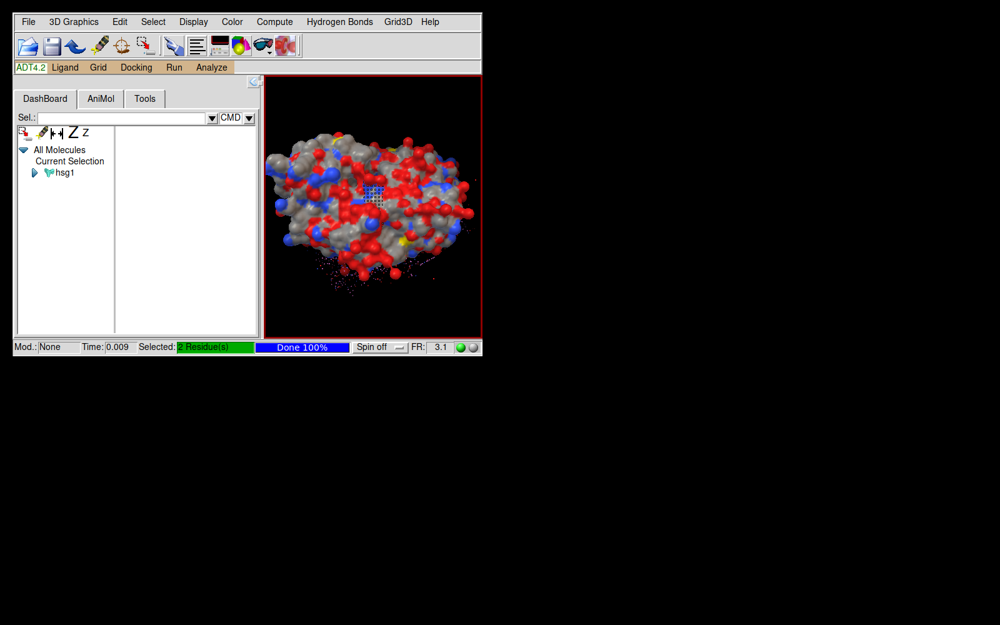

# MGLTools 1.5.6 on Python 3

A port of **MGLTools 1.5.6** — AutoDockTools (ADT), the Python Molecular Viewer
(PMV) and Vision — from Python 2.5 / Numeric / Togl to **Python 3.10+ /
NumPy 2 / modern OpenGL**, so it runs natively on current macOS (Apple
Silicon), Linux (x86_64, ARM64) and Windows (x64, ARM64).



## Install

```
pip install mgltools-*.whl      # wheel from the CI artifacts / releases
adt                             # AutoDockTools
pmv                             # Python Molecular Viewer
vision                          # Vision
```

Requires a Python with Tk (python.org installers, Homebrew `python-tk`, or
your Linux distribution's `python3-tk`). Dependencies (NumPy, SciPy, Pillow,
Pmw, PyOpenGL, tkinter-gl, SimPy 2.3.1) are installed automatically.

The ADT command-line scripts work as before, e.g.

```
python -m AutoDockTools.Utilities24.prepare_receptor4 -r hsg1.pdb -o hsg1.pdbqt
```

## What was validated

| Check | Result |
|---|---|
| ADT `prepare_receptor4`, `prepare_ligand4`, `prepare_gpf4`, `prepare_dpf42` on the ADT tutorial (hsg1 + indinavir) | **byte-identical** to MGLTools 1.5.6 (`tests/test_adt_pipeline.py`) |
| Molecular surface (mslib) vs MSMS 1.4.4 on hsg1 | vertices within 0.12 Å (sd) of the analytical SES, no bias; SES area −3 %, volume −2 % (`tests/test_mslib.py`) |
| All 18 native extensions | import and run; heap-checked (`tests/test_native.py`) |
| PMV/ADT GUI | starts, loads a molecule, lines/sticks/CPK/ribbon/surface/selection/colouring render (`tests/gui_smoke.py`) |

## How the port works

* **Python 2 → 3**: `tools/convert_py.py` (2to3 plus text rules),
  `tools/fix_py3_misc.py`, `tools/fix_code_strings.py` (code stored in
  strings: resource files, Vision nodes), `tools/convert_division.sh`
  (`/` → `old_div`, Python 2 integer division semantics).
* **Compatibility shims** in `src/mglcompat/`: `numpy.oldnumeric`
  (Numeric API on NumPy 2), Python 2 `string`/`types`/`user`/`Canvas`
  modules, `cmp`, old-style-class properties, Tk 8.4 leniency on Tk 8.6+
  (`tkcompat`), non-fatal GLX errors (`x11errors`).
* **Native code** (`native/`, 1.5.4 sources): SWIG 4 wrappers rebuilt for
  Python 3 and NumPy 2 (`native/common/mgl_npcompat.h`,
  `mgl_py2compat.h`, `tools/patch_native.py`).
* **OpenGL**: opengltk's SWIG GL/GLU bindings are replaced by **PyOpenGL**
  with adapters keeping opengltk's conventions (`src/opengltk/_pyogl.py`);
  the Tk GL widget is **TkGL** (a maintained Togl 2 descendant) instead of
  Togl 1.7.
* **Molecular surfaces**: MSMS was only available as closed binaries for old
  platforms. `src/mslib/` is an open-source, MSMS-API-compatible replacement
  (grid-based solvent excluded surface + marching cubes).

## Known limitations

* Surfaces: narrow channels thinner than the grid step (~0.6 Å at the default
  density) may be closed off, so a few internal-pocket surface patches MSMS
  shows can be missing. SES areas are ~3–5 % lower than MSMS's analytical
  values.
* Accumulation buffers (jittered anti-aliasing) and multisampling are opt-in
  (`MGL_GL_ACCUM=1`, `MGL_GL_MULTISAMPLE=1`); many modern drivers lack them.
* Not ported: `cMolKit` GROMACS `.xtc` reader on Windows (no XDR library),
  the Blender/Cinema4D/Maya plugins, web-service (ZSI) clients.
* Licensing is unchanged: MGLTools is free for non-commercial use; `mslib`
  here is new code. See `LICENSES`.

## Development

```
python setup.py build_ext --inplace        # build extensions into src/
MGL_USE_SRC=1 python -m pytest              # test the in-place build
tests/compare_adt.sh, tests/compare_msms.sh # compare with a local MGLTools 1.5.6
```
