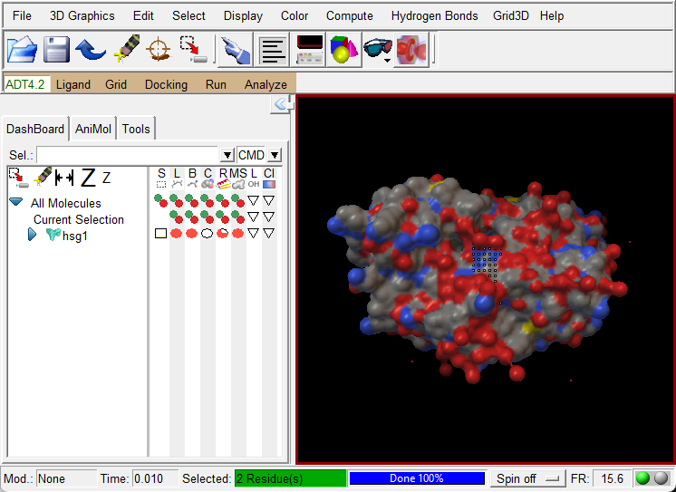
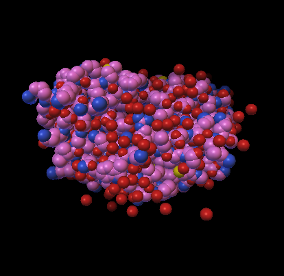

# MGLTools 1.5.6 for Python 3 — AutoDockTools GUI, portable for Windows

**AutoDockTools (ADT)**, the **Python Molecular Viewer (PMV)** and **Vision** from
MGLTools 1.5.6, ported from Python 2.5 / Numeric / Togl to **Python 3 /
NumPy 2 / modern OpenGL**.

The Windows release is **portable**: no installation, no Python needed.
Download, unzip, double-click `adt.exe`.
A Linux x86_64 package is also available — see
[Download and run (Linux)](#download-and-run-linux).

> ### ⬇️ [Download for Windows (MGLTools-1.5.6-Py3-Win64-Portable.zip, ~110 MB)](https://github.com/Leishem/MGLTools-Py3/releases/latest/download/MGLTools-1.5.6-Py3-Win64-Portable.zip)
>
> **Do not use the green `<> Code` → *Download ZIP* button.** That gives you the
> source code only — it has **no `adt.exe`**. The ready-to-run program is the
> zip file above (also listed under **Releases** on the right side of this page).



## Download and run (Windows)

1. Download **[`MGLTools-1.5.6-Py3-Win64-Portable.zip`](https://github.com/Leishem/MGLTools-Py3/releases/latest/download/MGLTools-1.5.6-Py3-Win64-Portable.zip)**.
   - Or open the [Releases page](https://github.com/Leishem/MGLTools-Py3/releases/latest),
     scroll to **Assets** and click that zip file.
   - ⚠️ Not the green **`<> Code` → Download ZIP** button, and not the
     **Source code (zip)** / **Source code (tar.gz)** links under Assets —
     those contain only source code and **no `adt.exe`**.
2. Right-click the downloaded zip → **Extract All…** → **Extract**. Any folder
   works, even a USB drive.
3. Open the extracted folder and double-click **`adt.exe`** (AutoDockTools),
   **`pmv.exe`** (molecular viewer) or **`vision.exe`** (Vision).

The folder you get should look like this:

```
MGLTools-1.5.6-Py3-Win64-Portable    adt.exe        <- AutoDockTools
    pmv.exe        <- molecular viewer
    vision.exe     <- Vision
    adt-util.bat   <- command-line preparation scripts
    python\        <- bundled Python (do not delete)
```

If you don't see `adt.exe`, you downloaded the source code instead — go back to step 1.

If Windows SmartScreen shows "Windows protected your PC", click
**More info → Run anyway** (the launchers are not code-signed).

### Supported systems

| Processor | Status |
|---|---|
| Intel / AMD 64-bit (x64) | Native — tested |
| ARM64 (e.g. Qualcomm Snapdragon) | Runs through Windows 11's built-in x64 emulation — expected to work, not yet tested |

Windows 10 or 11 (64-bit) with a current graphics driver (Intel, AMD or NVIDIA).
32-bit Windows is not supported.

### Command-line preparation scripts

From a command prompt in the unzipped folder:

```
adt-util.bat prepare_receptor4.py -r receptor.pdb -o receptor.pdbqt
adt-util.bat prepare_ligand4.py   -l ligand.pdb   -o ligand.pdbqt
adt-util.bat prepare_gpf4.py      -l ligand.pdbqt -r receptor.pdbqt -o grid.gpf
adt-util.bat prepare_dpf42.py     -l ligand.pdbqt -r receptor.pdbqt -o dock.dpf
```

Settings are stored in `%USERPROFILE%\.mgltools\1.5.6-py3`, separate from any
original MGLTools 1.5.6 installation.

## Download and run (Linux)

The Linux package (x86_64) runs on the system's **Python 3.12** — the default on
**Ubuntu 24.04**, where it is tested (also under WSL2 on Windows 11). Other
distributions work if they provide Python 3.12 at `/usr/bin/python3.12`.

1. Install the system packages (Ubuntu 24.04 / Debian-based):

   ```
   sudo apt update
   sudo apt install python3.12 python3-tk libgl1 libglu1-mesa
   ```

2. Download and extract
   **[`MGLTools-1.5.6-Py3-Linux-x86_64-Portable.tar.gz`](https://github.com/Leishem/MGLTools-Py3/releases/latest/download/MGLTools-1.5.6-Py3-Linux-x86_64-Portable.tar.gz)**:

   ```
   wget https://github.com/Leishem/MGLTools-Py3/releases/latest/download/MGLTools-1.5.6-Py3-Linux-x86_64-Portable.tar.gz
   tar -xzf MGLTools-1.5.6-Py3-Linux-x86_64-Portable.tar.gz
   cd MGLTools-1.5.6-Py3-Linux-x86_64-Portable
   ```

3. Start a program:

   ```
   ./adt       # AutoDockTools
   ./pmv       # molecular viewer
   ./vision    # Vision
   ```

The folder you get should look like this:

```
MGLTools-1.5.6-Py3-Linux-x86_64-Portable/
    adt  pmv  vision   <- launchers
    adt-util           <- command-line preparation scripts
    python-env/        <- bundled Python packages (do not delete)
```

If a launcher says `Permission denied`, restore the execute bits:
`chmod +x adt pmv vision adt-util python-env/bin/python*`.
The built-in Python shell window needs IDLE (`sudo apt install idle-python3.12`);
without it ADT still runs, with the shell disabled.

Command-line preparation scripts, from the extracted folder:

```
./adt-util prepare_receptor4.py -r receptor.pdb -o receptor.pdbqt
./adt-util prepare_ligand4.py   -l ligand.pdb   -o ligand.pdbqt
./adt-util prepare_gpf4.py      -l ligand.pdbqt -r receptor.pdbqt -o grid.gpf
./adt-util prepare_dpf42.py     -l ligand.pdbqt -r receptor.pdbqt -o dock.dpf
```

Run `./adt-util` with no arguments to list all available scripts.

## Build and run (macOS)

There is no macOS package yet; build from source. Tested on **macOS 27**
(Apple Silicon) with Homebrew's Python 3.12 and **Tk 9.0**.

1. Install the Command Line Tools, Python 3.12 and its Tk 9 module:

   ```
   xcode-select --install
   brew install python@3.12 python-tk@3.12
   ```

2. Build in a virtual environment:

   ```
   git clone https://github.com/Leishem/MGLTools-Py3
   cd MGLTools-Py3
   /opt/homebrew/bin/python3.12 -m venv .venv
   .venv/bin/pip install .
   ```

3. Start a program:

   ```
   .venv/bin/adt       # AutoDockTools
   .venv/bin/pmv       # molecular viewer
   .venv/bin/vision    # Vision
   ```

Command-line preparation scripts:

```
.venv/bin/python -m AutoDockTools.Utilities24.prepare_ligand4 -l ligand.pdb -o ligand.pdbqt
```

Notes:

* Use Tk 9. With Tk 8.6.13 to 8.6.16 (for example from conda), ADT stays on
  the splash screen on macOS 27: Tk's `update()` never returns.
* If linking fails with `Compiling with an SDK that doesn't seem to exist`,
  your Python was built against an SDK the Command Line Tools no longer ship.
  Point the linker to the current one:

  ```
  SDK=$(xcrun --show-sdk-path)
  LDSHARED="clang -bundle -undefined dynamic_lookup -isysroot $SDK" \
  LDCXXSHARED="clang++ -bundle -undefined dynamic_lookup -isysroot $SDK" \
  .venv/bin/pip install .
  ```

## Reporting a problem

Please [open an issue](../../issues/new/choose) and include:

- **a screenshot** of the problem (and of the Python shell window if an error
  appears there),
- your Windows version and processor (*Settings → System → About*) and graphics card,
- the steps that led to the problem and, if possible, the input files.

## What was validated

| Check | Result |
|---|---|
| `prepare_receptor4`, `prepare_ligand4`, `prepare_gpf4`, `prepare_dpf42` on the ADT tutorial (HIV protease hsg1 + indinavir) | **byte-identical** output to the original MGLTools 1.5.6, on Windows and Linux |
| Molecular surface vs the original MSMS | vertices within ~0.1 Å of MSMS's surface; area within ~3 % |
| GUI | loads molecules; lines, sticks & balls, CPK, ribbons, molecular surfaces, selection and colouring render correctly |

| CPK | Ribbon |
|---|---|
|  |  |

## How it was ported

* **Python 2 → 3**: automated conversion plus compatibility shims for Python 2
  behaviour the code relies on (`src/mglcompat/`).
* **Native code**: the 15 C/C++ extension modules were rebuilt for Python 3 and
  NumPy 2 with SWIG 4 (`native/`).
* **OpenGL**: the old Togl widget and SWIG GL bindings were replaced by
  [TkGL](https://github.com/3-manifolds/tkinter_gl) and PyOpenGL.
* **Molecular surfaces**: MSMS was available only as closed binaries for old
  platforms; `src/mslib/` is a new open-source, MSMS-compatible implementation.

### Building from source

```
pip install .                       # Windows needs Visual Studio Build Tools
adt                                 # or pmv / vision
python -m pytest                    # test suite (compares with MGLTools 1.5.6 outputs)
```

A portable Linux x86_64 package is published with each release — see
[Download and run (Linux)](#download-and-run-linux). For macOS, see
[Build and run (macOS)](#build-and-run-macos); a macOS package is not
published yet.

## Known limitations

* Surfaces: channels narrower than the surface grid (~0.6 Å at the default
  density) may be closed, so a few internal-pocket patches can be missing.
* Not included: the GROMACS `.xtc` trajectory reader on Windows, web-service
  (Opal/ZSI) clients, and the Blender/Cinema 4D/Maya plugins.

## License

MGLTools is © The Scripps Research Institute and is **free for non-commercial
educational and academic research use**; some components (e.g. the UT
packages) carry their own academic terms. See [`LICENSES`](LICENSES). This
port does not change those terms. For commercial use, contact the original
authors.

Original software: [MGLTools](https://ccsb.scripps.edu/mgltools/) by the
Molecular Graphics Laboratory, The Scripps Research Institute.
